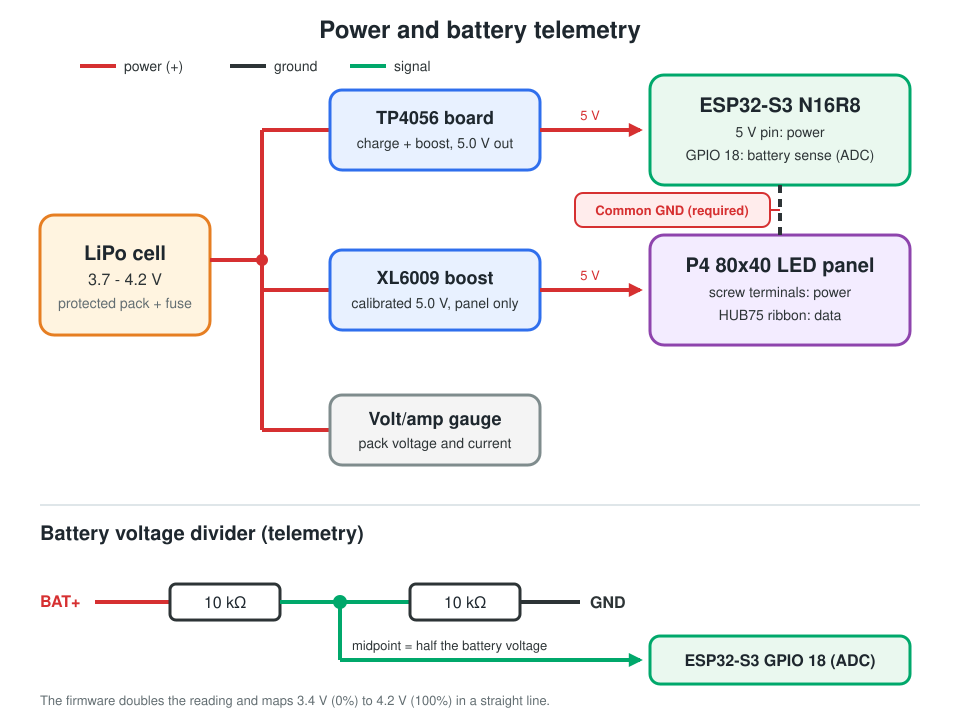
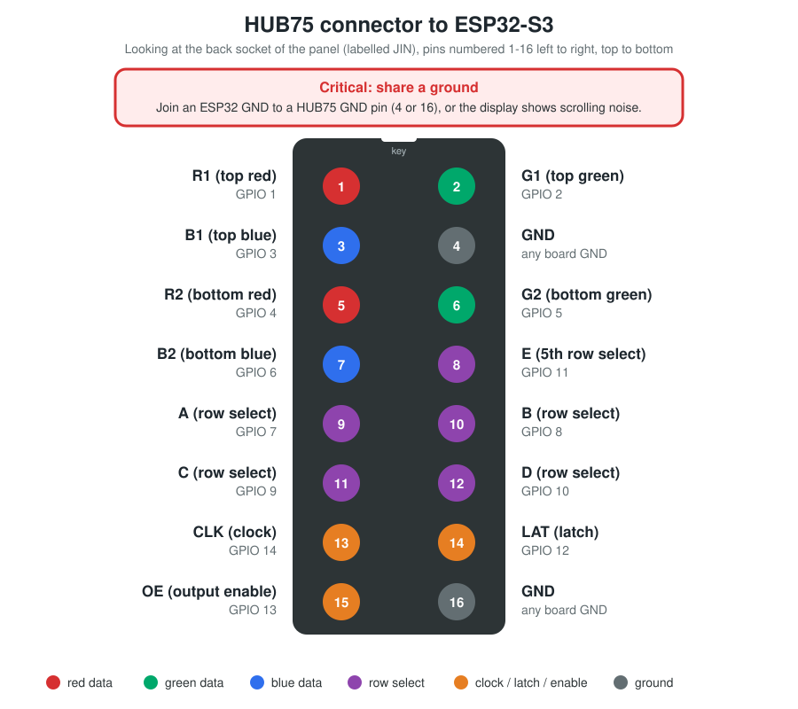

# ESP32-S3 HUB75 P4 LED Matrix Scoreboard Firmware

This repository contains the resilient, optimized C++ firmware required to transform an **ESP32-S3 N16R8** development module into an ultra-responsive, pure display server driving an **80x40 P4 HUB75 LED Matrix Panel** with a demanding 1/20 scan rate multiplex architecture. 

## ✨ Key Features

- **Pure Display Slave Architecture:** All complex string formatting, language localizations, and clock cycles are handled by the paired iPhone application. The chip extracts layout control bytes and instantly draws what the app transmits, preventing processing lag.
- **Persistent Naming & Renaming:** Allows users to name their board dynamically from the smartphone remote (e.g., *"Juan's Board"*). The string is saved securely to non-volatile internal flash memory using the `Preferences` library and automatically updates the BLE broadcast identity profile.
- **Configurable Colors:** The phone app sets the color of the timer (running and stopped), the period, each team's name and score, and the two start alerts. The board saves them in flash (`CMD_SET_COLORS`), so they survive reboots. A visibility bitmask (`CMD_SET_VISIBILITY`) hides any element, including either start alert, and is saved in flash too.
- **Start Alerts:** When the app starts a game or period it sends `CMD_ALERT`: the border flashes and the message scrolls across the whole panel at 3x in the alert's color, then the scoreboard returns.
- **Smart Connection Recovery & Timeout:** 
  - *Searching:* Onboard RGB NeoPixel blinks **Solid Blue**.
  - *Connected:* Transitions cleanly to **Solid Green**.
  - *Accidental Dropout:* Blinks **Cyan (Blue/Green Mix)** for 30 seconds while waiting to catch its previous companion phone. If the 30-second window expires, it wipes its display to zero parameters and opens the airwaves for a clean connection.
- **Analog Battery Monitoring:** Continuously samples raw analog cell voltages through a 10-sample average on **GPIO 18**, scaling the cell voltage linearly from 3.4 V (0%) to 4.2 V (100%) and sending it in the BLE telemetry notification. The divider halves the voltage, so the firmware doubles the reading.
- **Silent Network IDE OTA Programming:** Runs a background `ArduinoOTA` server. After the initial wire flash, your board registers wirelessly inside your Arduino IDE as a **Network Port**, allowing you to update the board over Wi-Fi without un-boxing the enclosure housing.

## 🔌 Hardware Pin Mapping Blueprint

Connect your 16-pin HUB75 display ribbon cable over to your ESP32-S3 development board using this safe, non-restricted GPIO matrix map:

| HUB75 Ribbon Connector Pin | Pin Function | Target ESP32-S3 GPIO Pin |
| :--- | :--- | :--- |
| Pin 1 | **R1** (Top Red Data) | **GPIO 1** |
| Pin 2 | **G1** (Top Green Data) | **GPIO 2** |
| Pin 3 | **B1** (Top Blue Data) | **GPIO 3** |
| Pin 5 | **R2** (Bottom Red Data) | **GPIO 4** |
| Pin 6 | **G2** (Bottom Green Data) | **GPIO 5** |
| Pin 7 | **B2** (Bottom Blue Data) | **GPIO 6** |
| Pin 8 | **E** (5th Row Select Line) | **GPIO 11** |
| Pin 9 | **A** (Row Select Line A) | **GPIO 7** |
| Pin 10 | **B** (Row Select Line B) | **GPIO 8** |
| Pin 11 | **C** (Row Select Line C) | **GPIO 9** |
| Pin 12 | **D** (Row Select Line D) | **GPIO 10** |
| Pin 14 | **LAT / STB** (Latch Data) | **GPIO 12** |
| Pin 15 | **OE** (Output Enable) | **GPIO 13** |
| Pin 13 | **CLK** (Clock Signal) | **GPIO 14** |
| Pins 4, 16 | **GND** (Ground Reference) | **Any Board GND Pin** |

> The pin numbers follow the labels printed on the panel's input socket (`JIN`): the left column reads R1, B1, R2, B2, A, C, CLK, OE and the right column G1, GND, G2, **E**, B, D, LAT, **GND**, top to bottom. E is on pin 8 and ground on pins 4 and 16. Check the printed labels on your own panel before wiring: panels differ.

### Panel power connector

The panel's power input is a 4-pin header labelled `POWER`: two `VCC` and two `GND` pins. Connect both VCC pins to the 5 V from the XL6009 and both GND pins to its ground, so the current (up to about 1.5 A) is shared. Power it only from the XL6009: a small charge or power-bank board cannot carry it.

### Onboard Status Indicator
- **Onboard WS2812B RGB NeoPixel:** Driven natively on **GPIO 48**.

### Resistor Divider Telemetry (Battery Tracker)
- Solder two matching **10kΩ resistors** in series between the battery positive **after the switch** (`BAT+`) and Ground (`GND`). Tap a wire from the middle junction point directly to **GPIO 18**.
- The junction sits at half the cell voltage: 1.7 V (empty, 3.4 V) to 2.1 V (full, 4.2 V), safely inside the ADC range. Never connect `BAT+` straight to the pin.

## ⚙️ Arduino IDE Compilation Configuration

To prevent flash memory restriction errors (`[Errno 32] Broken Pipe`), apply these exact board setup values under the **Tools** menu before compilation:

- **Board:** `ESP32S3 Dev Module`
- **Flash Size:** `16MB (128Mb)`
- **Partition Scheme:** `16MB Flash (2MB APP/12.5MB FATFS)`
- **PSRAM:** `Disabled` (the firmware does not use PSRAM. With `OPI PSRAM` selected, a board whose PSRAM is faulty restarts in a loop at power-up and never runs the sketch)
- **Upload Mode:** `UART0 / Hardware CDC`
- **USB CDC On Boot:** `Enabled`

### Panel colors wrong or the display blank?

`tools/panel-test/panel-test.ino` is a small sketch that shows four colour bands (red, green, blue, white) and repeats them for each driver chip type the display library supports, so you can see which one your panel needs. Its header explains how to read the result. If the board restarts in a loop and never starts, build with **PSRAM: Disabled**.

### Network Credentials & OTA Setup
Wi-Fi and OTA credentials are kept out of the sketch in a **gitignored** `secrets.h`:

1. Copy `secrets.h.example` to `secrets.h` (same folder as the `.ino`).
2. Fill in `WIFI_SSID`, `WIFI_PASSWORD` and choose your own `OTA_PASSWORD`.
3. Flash once over USB-C. Afterwards pick the board under **Tools > Port > Network Ports** and enter your OTA password to update wirelessly.

`secrets.h` is listed in `.gitignore`; never commit it.

## 📡 Bluetooth LE Protocol

One service, two characteristics. Keep these tables in sync with `AdvancedBLEManager.swift` in the BLEScoreboard app.

| Item | UUID |
| :--- | :--- |
| Service | `12345678-1234-1234-1234-123456789012` |
| State characteristic (read / write / notify) | `87654321-4321-4321-4321-210987654321` |
| Config characteristic (write / notify) | `87654321-4321-4321-4321-210987654322` |

### State: phone → board (write, 8 bytes + optional text)

| Byte | Field | Notes |
| :--- | :--- | :--- |
| 0 | Home score | 0-255 (the app limits it to 0-99) |
| 1 | Away score | same |
| 2 | Period | |
| 3 | Brightness | clamped by the firmware to 10-120 |
| 4 | Timer minutes | |
| 5 | Timer seconds | |
| 6 | Timer running | `1` = running |
| 7 | Total periods | |
| 8+ | Text (optional) | ASCII `home\|away\|ratio\|bottomLabel` |

Panel layout (80 x 40, no frame, 3x5 pixel font, capital letters only):

| Area | What is drawn |
| :--- | :--- |
| Top left | Timer `MM:SS` at 2x, green while running and orange when stopped |
| Top right | Period tracker `period/total` at 2x, yellow |
| Middle | Scores at 3x (9 x 15 px per digit), centered under each team |
| Bottom | Team names at 2x (6 x 10 px per letter), blue for home and red for away |

Panel behavior:
- **Team names** are kept up to 20 characters and shown in capitals. Each name has half the panel (36 px). A name of up to 4 letters is centered; a longer one scrolls from right to left like a marquee, pausing briefly at the start of each pass.
- **Timer and period** are drawn from the header bytes (minutes, seconds, running flag, period, total periods), not from the text, so they always show even if the text is cut. The ratio and label fields of the text are still sent for older firmware but ignored.
- **The board counts its own seconds** while the clock runs and resyncs on every write, so the clock keeps moving if the phone link drops. After 30 seconds without a phone it resets to `10:00`.
- The text must be plain ASCII because the panel font has no accents; the app strips them. Writes shorter than 8 bytes are ignored. The board asks for a 185 byte MTU so names fit in one write; at the default MTU of 23 a write would be cut at 20 bytes.

### Telemetry: board → phone (notify every 2 s while connected)

| Byte | Field | Notes |
| :--- | :--- | :--- |
| 0 | Timer minutes | |
| 1 | Timer seconds | |
| 2 | Timer running | |
| 3 | Period | |
| 4 | Battery % | 0-100 |
| 5 | Flags | bit 0 = battery below 15%, bit 1 = a new name is staged |
| 6 | Protocol version | currently `9`; the app uses it only to know which commands the board understands |
| 7-9 | Firmware version | major, minor, patch (for example `1`, `0`, `0` is version 1.0.0); absent on firmware older than 1.0.0 |

The app shows "firmware outdated" when it receives a shorter packet or a lower version than it expects. Bump `PROTOCOL_VERSION` in the sketch and `expectedProtocolVersion` in the app together whenever a layout changes.

### Config: renaming the board

Write `[command, args...]` to the config characteristic; each command is answered by a `[command, status]` notification (status `0` = OK, `1` = bad argument, `2` = nothing staged).

| Command | Bytes | Effect |
| :--- | :--- | :--- |
| `0x01` Set name | `01` + 1-20 printable ASCII bytes | Stages the name; nothing is saved yet |
| `0x02` Apply | `02` | Saves the staged name to flash and reboots |
| `0x03` Set colors | `03` + 9 x RGB565 (2 bytes each, big-endian) | Sets the color of each piece of panel text and saves them to flash. Order: timer running, timer stopped, period, home name, home score, away name, away score, game start alert, period start alert |
| `0x04` Alert | `04`, type (`1` game start, `2` period start, `3` goal), 1-32 ASCII characters (16 before protocol 8) | Plays the alert: the text scrolls across the whole panel at 3x in the alert's color while the border flashes, then the scoreboard returns |
| `0x05` Set visibility | `05` + 2 bytes, little-endian bitmask | Bit i set shows element i, in the same order as the colors (timer running, timer stopped, period, home name, home score, away name, away score, game start alert, period start alert). The timer uses the running bit for both states. A cleared alert bit means that alert does not play. Saved to flash |
| `0x06` Alert icon | `06`, first row (0-15) + 1-4 rows of 16 pixels (RGB565, big-endian, 32 bytes per row); `06` alone removes it | Loads the 16x16 picture that the goal alert (`04` type `3`) scrolls in front of its text |
| `0x07` Name icon | `07`, slot (0-3), first row (0-9) + 1-5 rows of 10 pixels (RGB565, big-endian, 20 bytes per row); `07`, slot alone clears it | Loads a 10x10 emoji picture. A team name (and a goal alert) shows picture N where it holds the byte N: slots 0-1 are the home name, 2-3 the away name |
| `0x08` End text | `08` + 1-32 ASCII characters | The text the board scrolls by itself when the last period runs out (protocol 9). The app sends it in its language |

### Connection states
After the first state packet of a session, an unexpected disconnect starts a 30 second cyan "retrying" window for the same phone. If no state was received yet, or the window expires, the board returns to blue "searching" and resets the display.

## 🔌 Wiring Blueprint

### Power and battery telemetry

<p align="center"></p>

How the battery percentage is made:

1. The two 10 kΩ resistors halve the cell voltage, and the ESP32-S3 reads the midpoint on **GPIO 18** (12-bit ADC).
2. The firmware averages 10 readings, doubles the result and maps **3.4 V to 0 %** and **4.2 V to 100 %** in a straight line.
3. The percentage goes out as byte 4 of the telemetry notification every 2 seconds, and the app shows it as the battery icon next to the unit name (red below 15 %, which is also flag bit 0).

Good to know:

- **The divider is after the switch.** It draws about 0.2 mA from the cell (4.2 V / 20 kΩ) only while the scoreboard is switched on, so a cell left switched off is not drained by it.
- **The reading is taken under load.** The cell voltage sags while the panel draws 1 - 2 A, so the percentage dips during a game and recovers when the load drops.
- **GPIO 18 is on the ADC2 unit.** Espressif documents that ADC2 readings can fail while Wi-Fi is running (see the [ESP32-S3 ADC notes](https://docs.espressif.com/projects/esp-idf/en/v4.4.5/esp32s3/api-reference/peripherals/adc.html)), and this firmware keeps Wi-Fi on for wireless uploads. If the percentage ever sticks at 0 % or 100 %, that is the first thing to suspect. GPIO 1 - 10 (the ADC1 unit) are all taken by the HUB75 wiring.
- **The gauge goes in series.** Put the volt/amp gauge in line with `BAT+` so its current reading covers everything the cell feeds.

### HUB75 connector

<p align="center"></p>


## 🏷️ Versions

The firmware has a version number, `major.minor.patch`, set by `FW_VERSION_MAJOR`, `FW_VERSION_MINOR` and `FW_VERSION_PATCH` at the top of the sketch. Bump **patch** for fixes, **minor** for features that stay compatible, and **major** for breaking changes. The board reports it in its telemetry, and the app shows it and offers an update when the firmware bundled in the app is newer. `PROTOCOL_VERSION` is separate and internal: it only tells the app which commands the board understands. See [CHANGELOG.md](CHANGELOG.md).

## 📶 Updating over Bluetooth

After the first USB flash of a version that includes it, the board can be updated from the phone: open **Board Firmware** in the app and tap **Update board firmware**. The panel shows a progress bar and the board restarts when it is done.

- The app carries the firmware image. Build it with `tools/bundle-firmware.sh` in the app repository; the script also writes the update key from `secrets.h` next to the image, so nobody types a password. That folder is git-ignored because the image contains your Wi-Fi and update passwords. Never commit it.
- The board only accepts a transfer after the app answers a random challenge (HMAC-SHA256 of a nonce with `OTA_PASSWORD`); three wrong answers lock it for 30 seconds.
- The image is written to the spare firmware slot, checked with a CRC-32, and only then does the board switch to it. If anything fails the board keeps its current firmware. There is no automatic rollback if a new image crashes right after starting; a USB flash fixes that.
- Wi-Fi and USB updates keep working.

OTA characteristic `87654321-4321-4321-4321-210987654323` (write, write without response, notify). Messages from the phone start with an opcode; replies are notifications `[opcode, status, ...]`:

| Opcode | Message | Reply |
| :--- | :--- | :--- |
| `0x01` Begin | `01` | `01, status, 16-byte nonce` |
| `0x02` Auth | `02` + HMAC-SHA256(key, nonce), 32 bytes | `02, status` |
| `0x03` Start | `03` + size (u32 LE) + CRC-32 (u32 LE) | `03, status` once the slot is erased |
| `0x04` Data | `04` + up to 180 bytes, written without response | `05` + bytes written (u32 LE) every 4 KB |
| `0x06` End | `06`, sent after the last acknowledgement | `06, status`, then the board restarts |
| `0x07` Abort | `07` | none |

Status values: `0` ok, `1` bad argument, `2` wrong state, `3` auth failed, `4` image does not fit, `5` flash error, `6` CRC mismatch, `7` locked, `8` timeout.

## 🔋 Battery Sizing

> These figures are estimates for an 80x40 P4 panel running at the app's brightness limit. Measure your own build (see below) before buying a pack.

### How much power does it use?

| Part | Typical draw at 5 V |
| :--- | :--- |
| P4 80x40 panel (mostly dark, text only, brightness capped at 120/255) | 0.8 - 1.5 A |
| ESP32-S3 with Bluetooth and Wi-Fi | 0.1 - 0.2 A |

The boost converters lose about 15%, so the battery supplies roughly **5 - 9 W**, or about **1.4 - 2.5 A at 3.7 V**. Bright, full-white content draws more.

### Recommended pack

A **single-cell 3.7 V pack of 8,000 - 10,000 mAh with a protection circuit** covers a full day of games with breaks and setup time. Three protected 18650 cells in parallel (about 9,000 mAh) work well. 5,000 mAh is the minimum if you run only one or two games per charge.

| Pack | Approximate runtime |
| :--- | :--- |
| 5,000 mAh | 1.7 - 3 h |
| 8,000 mAh | 2.8 - 5 h |
| 10,000 mAh | 3.5 - 6 h |

Runtimes assume 85% of the rated capacity is usable and a 5 - 9 W draw.

### Measure it yourself

Run a normal game at your usual brightness for about 10 minutes and read the average current from the round volt/amp gauge. Then:

```
capacity needed (Ah) = average current (A) x hours wanted / 0.8
```

### Things to watch

- **Use a protected pack** (or a BMS) and put a **5 A fuse** on the battery positive wire, as close to the cell as you can, followed by a **switch rated 10 A or more**. A small slide switch (a few hundred mA) will overheat. Use wire of 20 AWG or thicker between the cell and the XL6009. Do not use bare, unprotected LiPo cells.
- **Charge with the load off, through a charge board that is not in the load path.** Connect the charge board (TP4056) to the cell terminals only and take the scoreboard's power from the cell through the fuse, the switch and the XL6009. If the panel's current passes through a small charge or power-bank board, that board overheats and the 5 V sags, which first kills the green and blue LEDs. The TP4056 charges at 1 A at most and gets warm doing it, so a 10 Ah pack needs 10 hours or more; for packs above about 6 Ah, consider a faster charger with better cooling.
- **The XL6009** is rated for 4 A of switch current. It is a step-up converter: feed it from the **battery** (3.0 - 4.2 V), never from a 5 V output, and set its output to 5.0 V with no load before you connect the panel and the ESP32. At 3.7 V in, a 1.5 A panel load already needs about 2.4 A from the battery, so expect it to get warm and check that the panel does not spike above that at full white.
- **The battery percentage is approximate.** The firmware scales 3.4 V (0%) to 4.2 V (100%) in a straight line, while a real LiPo discharge curve is not linear. Use it as a rough gauge, not a fuel meter.
